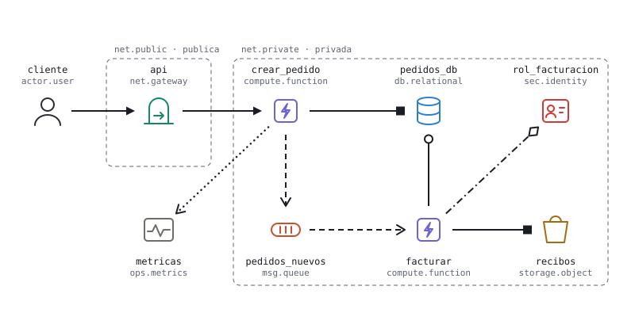

# Nimbo

Lenguaje gráfico para diseñar arquitecturas en la nube sin atarse a un proveedor.

Cada icono representa un **rol** (una cola, una base relacional, un modelo de IA), nunca un producto concreto. Cada flecha es una **relación tipada** (llamada, mensaje, lectura, escritura, confianza…) de la que se pueden deducir permisos, red y recursos intermedios. Una tabla de equivalencias traduce cada rol al servicio de AWS, Microsoft Azure o Google Cloud.



## Qué incluye la versión 0.1

- **103 componentes** en 10 familias. 88 existen en los tres proveedores.
- **10 relaciones** con trazo y punta propios.
- **Tabla de equivalencias** con AWS, Azure y Google Cloud, revisada en octubre de 2026.
- **Catálogo web** navegable, listo para GitHub Pages.
- **Formato de archivo** JSON para guardar diagramas, con un ejemplo.

Esta versión define el lenguaje. El editor, la generación de infraestructura y la comparación de costos vienen después.

## Estructura

```
spec/                     Fuente de verdad. Todo lo demás se genera desde aquí.
  families.json           Las 10 familias y sus colores.
  components.json         Componentes: clave, nivel, descripción e icono.
  relations.json          Relaciones: estilo, significado y qué conectan.
  bindings/               Un archivo por proveedor con el servicio de cada componente.
  examples/               Diagramas de ejemplo en el formato del lenguaje.
scripts/
  build.mjs               Valida la especificación y genera los archivos.
  catalog.template.html   Plantilla del catálogo web.
icons/<familia>/          Iconos SVG con el color de su familia (generado).
icons/mono/               Iconos SVG en currentColor (generado).
relations/                Flechas SVG de cada relación (generado).
docs/
  index.html              Catálogo web (generado).
  equivalencias.md        Tabla de equivalencias por proveedor (generado).
  servicios-cloud.md      Visión de los servicios de nube y criterio de selección.
  lenguaje.md             Especificación del lenguaje y del formato de archivo.
```

## Uso

Requiere Node.js 18 o superior. No tiene dependencias.

```bash
npm run build   # valida spec/ y regenera iconos, relaciones, catálogo y tablas
npm run check   # falla si spec/ es inválida o los archivos generados están desactualizados
```

Para ver el catálogo, abre `docs/index.html` en el navegador.

## Cómo contribuir

1. Edita solo lo que está en `spec/` (o la plantilla del catálogo).
2. Corre `npm run build`.
3. Sube los cambios junto con los archivos generados. La integración continua corre `npm run check` en cada pull request.

Para agregar un componente, súmalo a `spec/components.json` y agrega su servicio en cada archivo de `spec/bindings/`. Para agregar un proveedor, crea un nuevo archivo en `spec/bindings/`. Los criterios están en [docs/servicios-cloud.md](docs/servicios-cloud.md).

## Documentación

- [Especificación del lenguaje](docs/lenguaje.md)
- [Visión de los servicios de nube](docs/servicios-cloud.md)
- [Tabla de equivalencias](docs/equivalencias.md)

## Licencia

MIT. Los iconos son originales y no reproducen logotipos de ningún proveedor. Los nombres de servicios son marcas de sus dueños y aparecen solo como referencia.
