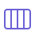
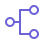
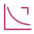
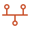
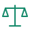
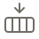
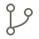
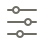
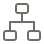

<!-- Archivo generado por scripts/build.mjs a partir de spec/. No lo edites a mano. -->
# Tabla de equivalencias

Cada componente del lenguaje y el servicio que lo implementa en cada proveedor. Revisado: Amazon Web Services 2026-10, Microsoft Azure 2026-10, Google Cloud 2026-10.

- **Núcleo:** los 3 proveedores tienen un servicio administrado con el mismo rol.
- **Extendido:** existe en algunos proveedores, o la equivalencia tiene diferencias importantes.
- **Notación:** elemento del lenguaje sin servicio que lo respalde.

| Familia | Núcleo | Extendido | Notación |
|---|---:|---:|---:|
| Cómputo | 10 | 3 | 0 |
| Bases de datos | 8 | 2 | 0 |
| Almacenamiento | 7 | 0 | 0 |
| Analítica | 9 | 0 | 0 |
| IA y ML | 15 | 0 | 0 |
| Mensajería e integración | 7 | 2 | 2 |
| Red | 11 | 1 | 0 |
| Seguridad | 10 | 0 | 0 |
| Operación y DevOps | 11 | 0 | 0 |
| Actores externos | 0 | 0 | 5 |
| **Total** | **88** | **8** | **7** |

## Cómputo

Donde corre el código: funciones, contenedores, máquinas y orquestación.

| Icono | Componente | Nivel | Amazon Web Services | Microsoft Azure | Google Cloud |
|---|---|---|---|---|---|
|  | **Función** `compute.function` | Núcleo | AWS Lambda | Azure Functions | Cloud Run functions |
|  | **Contenedor serverless** `compute.container` | Núcleo | Amazon ECS en AWS Fargate | Azure Container Apps | Cloud Run |
|  | **Máquina virtual** `compute.vm` | Núcleo | Amazon EC2 | Azure Virtual Machines | Compute Engine |
|  | **Grupo autoescalable** `compute.autoscale` | Núcleo | Amazon EC2 Auto Scaling | Azure Virtual Machine Scale Sets | Managed Instance Groups |
|  | **Kubernetes** `compute.cluster` | Núcleo | Amazon EKS | Azure Kubernetes Service (AKS) | Google Kubernetes Engine (GKE) |
|  | **Aplicación web administrada** `compute.webapp` | Núcleo | AWS Elastic Beanstalk | Azure App Service | App Engine |
|  | **Sitio estático** `compute.static` | Núcleo | AWS Amplify Hosting | Azure Static Web Apps | Firebase Hosting |
|  | **Proceso batch** `compute.batch` | Núcleo | AWS Batch | Azure Batch | Batch |
|  | **Orquestador** `compute.workflow` | Núcleo | AWS Step Functions | Azure Logic Apps / Durable Functions | Workflows |
|  | **Programador** `compute.schedule` | Extendido | Amazon EventBridge Scheduler | Disparador de temporizador en Azure Functions / recurrencia en Logic Apps | Cloud Scheduler |
|  | **Acelerador GPU** `compute.accelerator` | Núcleo | Instancias EC2 con GPU, AWS Trainium e Inferentia | Máquinas virtuales serie N | GPU y Cloud TPU |
|  | **Cómputo en el borde** `compute.edge` | Extendido | Amazon CloudFront Functions / Lambda@Edge | Motor de reglas de Azure Front Door (sin código propio) | — |
|  | **Nube en sitio** `compute.hybrid` | Extendido | AWS Outposts | Azure Local | Google Distributed Cloud |

- `compute.function`: Cloud Functions pasó a llamarse Cloud Run functions en 2024.
- `compute.schedule`: Azure no tiene un servicio de programación independiente desde que retiró Azure Scheduler; se resuelve con disparadores.
- `compute.edge`: Solo AWS ofrece ejecutar código propio en el borde como servicio nativo.
- `compute.hybrid`: Los tres existen pero difieren mucho en modelo de compra y servicios incluidos. Azure Stack HCI se renombró Azure Local.

## Bases de datos

Motores administrados por modelo de datos.

| Icono | Componente | Nivel | Amazon Web Services | Microsoft Azure | Google Cloud |
|---|---|---|---|---|---|
|  | **Relacional** `db.relational` | Núcleo | Amazon RDS / Amazon Aurora | Azure SQL Database / Azure Database for PostgreSQL y MySQL | Cloud SQL / AlloyDB |
|  | **Documental** `db.document` | Núcleo | Amazon DocumentDB | Azure Cosmos DB (NoSQL / MongoDB) | Firestore |
|  | **Clave-valor** `db.keyvalue` | Núcleo | Amazon DynamoDB | Azure Cosmos DB (Table) / Table Storage | Bigtable / Firestore |
|  | **Columnar ancha** `db.widecolumn` | Núcleo | Amazon Keyspaces | Azure Managed Instance for Apache Cassandra | Bigtable |
|  | **Grafo** `db.graph` | Núcleo | Amazon Neptune | Azure Cosmos DB for Apache Gremlin | Spanner Graph |
|  | **Vectorial** `db.vector` | Núcleo | Amazon S3 Vectors / OpenSearch Service | Azure AI Search / Cosmos DB (vectores) | Vertex AI Vector Search / AlloyDB (pgvector) |
|  | **Caché en memoria** `db.cache` | Núcleo | Amazon ElastiCache / MemoryDB | Azure Managed Redis | Memorystore |
|  | **Series de tiempo** `db.timeseries` | Extendido | Amazon Timestream | Azure Data Explorer | — |
|  | **Motor de búsqueda** `db.search` | Extendido | Amazon OpenSearch Service | Azure AI Search | Vertex AI Search |
|  | **Migración de bases** `db.migration` | Núcleo | AWS Database Migration Service | Azure Database Migration Service | Database Migration Service |

- `db.keyvalue`: En Google la elección depende del patrón: Bigtable para volumen, Firestore para apps.
- `db.vector`: Los tres también permiten pgvector en su PostgreSQL administrado.
- `db.cache`: Azure Cache for Redis está en retiro; su reemplazo es Azure Managed Redis.
- `db.timeseries`: Google no tiene motor dedicado; se resuelve con Bigtable o BigQuery. Azure Time Series Insights se retiró en 2025.
- `db.search`: Vertex AI Search es una búsqueda administrada de alto nivel; Google no ofrece OpenSearch o Elasticsearch propio.

## Almacenamiento

Objetos, discos, archivos, archivo frío, respaldo y transferencia.

| Icono | Componente | Nivel | Amazon Web Services | Microsoft Azure | Google Cloud |
|---|---|---|---|---|---|
|  | **Objetos** `storage.object` | Núcleo | Amazon S3 | Azure Blob Storage | Cloud Storage |
|  | **Disco de bloque** `storage.block` | Núcleo | Amazon EBS | Azure Managed Disks | Persistent Disk / Hyperdisk |
|  | **Archivos compartidos** `storage.file` | Núcleo | Amazon EFS / Amazon FSx | Azure Files / Azure NetApp Files | Filestore |
|  | **Archivo frío** `storage.archive` | Núcleo | Amazon S3 Glacier | Nivel Archive de Blob Storage | Clase Archive de Cloud Storage |
|  | **Respaldo** `storage.backup` | Núcleo | AWS Backup | Azure Backup | Backup and DR Service |
|  | **Data lake** `storage.lake` | Núcleo | Amazon S3 + AWS Lake Formation | Azure Data Lake Storage / OneLake | Cloud Storage + BigLake |
|  | **Transferencia** `storage.transfer` | Núcleo | AWS DataSync / AWS Transfer Family | Azure Storage Mover / Azure Data Box | Storage Transfer Service / Transfer Appliance |

## Analítica

Warehouse, pipelines, procesamiento y gobierno de datos.

| Icono | Componente | Nivel | Amazon Web Services | Microsoft Azure | Google Cloud |
|---|---|---|---|---|---|
|  | **Data warehouse** `analytics.warehouse` | Núcleo | Amazon Redshift | Microsoft Fabric Data Warehouse / Azure Synapse Analytics | BigQuery |
|  | **ETL / pipeline** `analytics.etl` | Núcleo | AWS Glue | Azure Data Factory | Dataflow / Cloud Data Fusion |
|  | **Procesamiento de streams** `analytics.streaming` | Núcleo | Amazon Managed Service for Apache Flink | Azure Stream Analytics | Dataflow |
|  | **Procesamiento distribuido** `analytics.distributed` | Núcleo | Amazon EMR | Azure Databricks / Azure HDInsight | Dataproc |
|  | **Consulta sobre el lago** `analytics.query` | Núcleo | Amazon Athena | Microsoft Fabric / Synapse SQL sin servidor | BigQuery (tablas externas y BigLake) |
|  | **Tablero BI** `analytics.bi` | Núcleo | Amazon Quick Sight | Power BI | Looker / Looker Studio |
|  | **Catálogo de datos** `analytics.catalog` | Núcleo | AWS Glue Data Catalog / Amazon SageMaker Catalog | Microsoft Purview | Dataplex Universal Catalog |
|  | **Linaje** `analytics.lineage` | Núcleo | Amazon SageMaker Catalog (linaje) | Microsoft Purview (linaje) | Dataplex (linaje de datos) |
|  | **Calidad de datos** `analytics.quality` | Núcleo | AWS Glue Data Quality | Microsoft Purview (calidad de datos) | Dataplex (calidad de datos) |

- `analytics.bi`: QuickSight pasó a formar parte de Amazon Quick (antes Quick Suite) y se escribe Quick Sight.
- `analytics.catalog`: Google Data Catalog fue absorbido por Dataplex Universal Catalog.

## IA y ML

Modelos fundacionales, plataforma de ML y APIs de IA listas.

| Icono | Componente | Nivel | Amazon Web Services | Microsoft Azure | Google Cloud |
|---|---|---|---|---|---|
|  | **Modelos fundacionales** `ai.llm` | Núcleo | Amazon Bedrock | Microsoft Foundry | Vertex AI (Gemini y Model Garden) |
|  | **Agente** `ai.agent` | Núcleo | Amazon Bedrock AgentCore | Foundry Agent Service | Vertex AI Agent Engine |
|  | **Base de conocimiento** `ai.knowledge` | Núcleo | Amazon Bedrock Knowledge Bases | Azure AI Search (recuperación agéntica) / Foundry | Vertex AI RAG Engine |
|  | **Guardrails** `ai.guardrail` | Núcleo | Amazon Bedrock Guardrails | Azure AI Content Safety | Model Armor |
|  | **Registro de modelos** `ai.model` | Núcleo | Amazon SageMaker AI Model Registry | Registros de Azure Machine Learning | Vertex AI Model Registry |
|  | **Entrenamiento** `ai.training` | Núcleo | Amazon SageMaker AI (entrenamiento) | Azure Machine Learning | Vertex AI Training |
|  | **Inferencia** `ai.inference` | Núcleo | Endpoints de Amazon SageMaker AI | Endpoints en línea de Azure Machine Learning | Endpoints de Vertex AI |
|  | **Pipeline de ML** `ai.pipeline` | Núcleo | Amazon SageMaker Pipelines | Pipelines de Azure Machine Learning | Vertex AI Pipelines |
|  | **Feature store** `ai.features` | Núcleo | Amazon SageMaker Feature Store | Feature store de Azure Machine Learning | Vertex AI Feature Store |
|  | **Notebook** `ai.notebook` | Núcleo | Amazon SageMaker Unified Studio | Notebooks de Azure Machine Learning | Vertex AI Workbench / Colab Enterprise |
|  | **Visión** `ai.vision` | Núcleo | Amazon Rekognition | Azure AI Vision | Cloud Vision API |
|  | **Voz** `ai.speech` | Núcleo | Amazon Transcribe / Amazon Polly | Azure AI Speech | Speech-to-Text / Text-to-Speech |
|  | **Lenguaje natural** `ai.nlp` | Núcleo | Amazon Comprehend | Azure AI Language | Cloud Natural Language API |
|  | **Traducción** `ai.translate` | Núcleo | Amazon Translate | Azure AI Translator | Cloud Translation |
|  | **Extracción de documentos** `ai.document` | Núcleo | Amazon Textract | Azure AI Document Intelligence | Document AI |

- `ai.llm`: Azure AI Foundry se renombró Microsoft Foundry en noviembre de 2025.

## Mensajería e integración

Colas, eventos, streams y conectores.

| Icono | Componente | Nivel | Amazon Web Services | Microsoft Azure | Google Cloud |
|---|---|---|---|---|---|
|  | **Cola** `msg.queue` | Núcleo | Amazon SQS | Azure Service Bus (colas) / Queue Storage | Cloud Tasks / Pub/Sub (suscripción pull) |
|  | **Topic** `msg.topic` | Núcleo | Amazon SNS | Azure Service Bus (topics) | Pub/Sub |
|  | **Bus de eventos** `msg.bus` | Núcleo | Amazon EventBridge | Azure Event Grid | Eventarc |
|  | **Stream** `msg.stream` | Núcleo | Amazon Kinesis Data Streams | Azure Event Hubs | Pub/Sub (con orden por clave) |
|  | **Kafka** `msg.kafka` | Núcleo | Amazon MSK | Azure Event Hubs (endpoint Kafka) | Managed Service for Apache Kafka |
|  | **Notificaciones push** `msg.notify` | Núcleo | Amazon SNS (push móvil) | Azure Notification Hubs | Firebase Cloud Messaging |
|  | **Conector SaaS** `msg.connector` | Núcleo | Amazon AppFlow | Conectores de Azure Logic Apps | Application Integration |
|  | **Correo** `msg.email` | Extendido | Amazon SES | Azure Communication Services (correo) | — |
|  | **Hub IoT** `msg.iot` | Extendido | AWS IoT Core | Azure IoT Hub | — |
|  | **API (contrato)** `msg.api` | Notación | — | — | — |
|  | **Webhook** `msg.webhook` | Notación | — | — | — |

- `msg.queue`: Google no tiene un servicio llamado cola de mensajes; Pub/Sub con suscripción pull cumple el rol.
- `msg.stream`: Pub/Sub no es un log reproducible por particiones como Kinesis o Event Hubs; para eso usar msg.kafka.
- `msg.kafka`: Event Hubs habla el protocolo Kafka, pero no es Kafka completo.
- `msg.email`: Google Cloud no tiene envío de correo propio; se usa un proveedor externo.
- `msg.iot`: Google retiró Cloud IoT Core en 2023.
- `msg.api`: Es documentación del lenguaje: describe la interfaz, no crea un recurso.
- `msg.webhook`: Patrón, no servicio. Se implementa con una función y una cola.

## Red

Zonas, entrada, distribución y conectividad.

| Icono | Componente | Nivel | Amazon Web Services | Microsoft Azure | Google Cloud |
|---|---|---|---|---|---|
|  | **Red privada** `net.private` | Núcleo | Amazon VPC | Azure Virtual Network | VPC |
|  | **Zona pública** `net.public` | Núcleo | Subred pública de VPC | Subred con IP pública | Subred con IP externa |
|  | **API gateway** `net.gateway` | Núcleo | Amazon API Gateway | Azure API Management | API Gateway / Apigee |
|  | **Balanceador** `net.loadbalancer` | Núcleo | Elastic Load Balancing | Azure Load Balancer / Application Gateway | Cloud Load Balancing |
|  | **CDN** `net.cdn` | Núcleo | Amazon CloudFront | Azure Front Door | Cloud CDN |
|  | **DNS** `net.dns` | Núcleo | Amazon Route 53 | Azure DNS | Cloud DNS |
|  | **Salida NAT** `net.nat` | Núcleo | NAT Gateway | Azure NAT Gateway | Cloud NAT |
|  | **Endpoint privado** `net.privatelink` | Núcleo | AWS PrivateLink | Azure Private Link | Private Service Connect |
|  | **Interconexión de redes** `net.peering` | Núcleo | VPC Peering / AWS Transit Gateway | VNet peering / Azure Virtual WAN | VPC Network Peering / Network Connectivity Center |
|  | **VPN** `net.vpn` | Núcleo | AWS Site-to-Site VPN | Azure VPN Gateway | Cloud VPN |
|  | **Enlace dedicado** `net.dedicated` | Núcleo | AWS Direct Connect | Azure ExpressRoute | Cloud Interconnect |
|  | **Service mesh** `net.mesh` | Extendido | Amazon VPC Lattice / ECS Service Connect | Complemento Istio para AKS | Cloud Service Mesh |

- `net.cdn`: Azure CDN clásico se reemplaza por Azure Front Door.
- `net.mesh`: AWS App Mesh deja de funcionar el 30 de septiembre de 2026.

## Seguridad

Identidad, secretos, cifrado, perímetro y cumplimiento.

| Icono | Componente | Nivel | Amazon Web Services | Microsoft Azure | Google Cloud |
|---|---|---|---|---|---|
|  | **Identidad y acceso** `sec.identity` | Núcleo | AWS IAM / IAM Identity Center | Microsoft Entra ID + Azure RBAC | Cloud IAM |
|  | **Identidad de clientes** `sec.customer` | Núcleo | Amazon Cognito | Microsoft Entra External ID | Identity Platform |
|  | **Bóveda de secretos** `sec.vault` | Núcleo | AWS Secrets Manager | Azure Key Vault (secretos) | Secret Manager |
|  | **Llaves de cifrado** `sec.kms` | Núcleo | AWS KMS | Azure Key Vault (llaves) / Managed HSM | Cloud KMS |
|  | **Certificados** `sec.certificate` | Núcleo | AWS Certificate Manager | Azure Key Vault (certificados) | Certificate Manager |
|  | **Firewall** `sec.firewall` | Núcleo | AWS Network Firewall / Security Groups | Azure Firewall / Network Security Groups | Cloud NGFW / reglas de firewall de VPC |
|  | **WAF y anti-DDoS** `sec.protection` | Núcleo | AWS WAF / AWS Shield | Azure Web Application Firewall / Azure DDoS Protection | Google Cloud Armor |
|  | **Políticas de organización** `sec.policy` | Núcleo | AWS Organizations (SCP) | Azure Policy | Organization Policy Service |
|  | **Auditoría** `sec.audit` | Núcleo | AWS CloudTrail | Registro de actividad de Azure | Cloud Audit Logs |
|  | **Postura y amenazas** `sec.posture` | Núcleo | AWS Security Hub / Amazon GuardDuty | Microsoft Defender for Cloud | Security Command Center |

## Operación y DevOps

Observabilidad, entrega, configuración y costos.

| Icono | Componente | Nivel | Amazon Web Services | Microsoft Azure | Google Cloud |
|---|---|---|---|---|---|
|  | **Métricas** `ops.metrics` | Núcleo | Amazon CloudWatch | Azure Monitor (métricas) | Cloud Monitoring |
|  | **Logs** `ops.logs` | Núcleo | Amazon CloudWatch Logs | Azure Monitor Logs (Log Analytics) | Cloud Logging |
|  | **Trazas** `ops.traces` | Núcleo | AWS X-Ray / CloudWatch Application Signals | Application Insights | Cloud Trace |
|  | **Alertas** `ops.alerts` | Núcleo | Alarmas de Amazon CloudWatch | Alertas de Azure Monitor | Alertas de Cloud Monitoring |
|  | **CI/CD** `ops.cicd` | Núcleo | AWS CodePipeline / AWS CodeBuild | Azure Pipelines | Cloud Build / Cloud Deploy |
|  | **Registro de artefactos** `ops.registry` | Núcleo | Amazon ECR | Azure Container Registry | Artifact Registry |
|  | **Repositorio de código** `ops.repo` | Núcleo | AWS CodeCommit | Azure Repos | Secure Source Manager |
|  | **Infraestructura como código** `ops.iac` | Núcleo | AWS CloudFormation | Bicep / Azure Resource Manager | Infrastructure Manager (Terraform) |
|  | **Configuración** `ops.config` | Núcleo | AWS AppConfig / Parameter Store | Azure App Configuration | Parameter Manager |
|  | **Costos** `ops.cost` | Núcleo | AWS Cost Explorer / AWS Budgets | Microsoft Cost Management | Cloud Billing (informes y presupuestos) |
|  | **Cuenta / proyecto** `ops.account` | Núcleo | Cuenta de AWS (AWS Organizations) | Suscripción y grupo de administración | Proyecto y carpeta de Resource Manager |

- `ops.registry`: Google Container Registry se apagó; su reemplazo es Artifact Registry.
- `ops.repo`: CodeCommit volvió a disponibilidad general a fines de 2025. Cloud Source Repositories no acepta clientes nuevos.
- `ops.iac`: Deployment Manager terminó su soporte el 31 de marzo de 2026.

## Actores externos

Lo que está fuera del sistema y lo usa.

| Icono | Componente | Nivel | Amazon Web Services | Microsoft Azure | Google Cloud |
|---|---|---|---|---|---|
|  | **Usuario** `actor.user` | Notación | — | — | — |
|  | **Navegador** `actor.web` | Notación | — | — | — |
|  | **App móvil** `actor.mobile` | Notación | — | — | — |
|  | **Dispositivo** `actor.iot` | Notación | — | — | — |
|  | **Sistema externo** `actor.external` | Notación | — | — | — |

